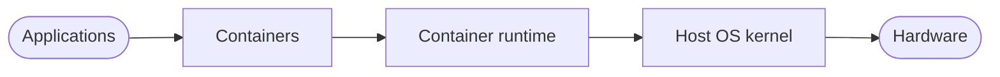
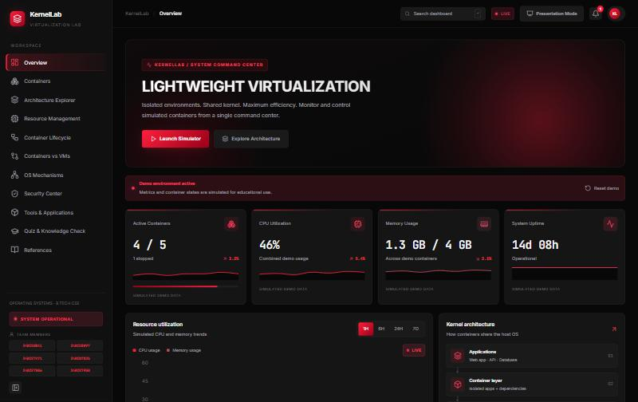
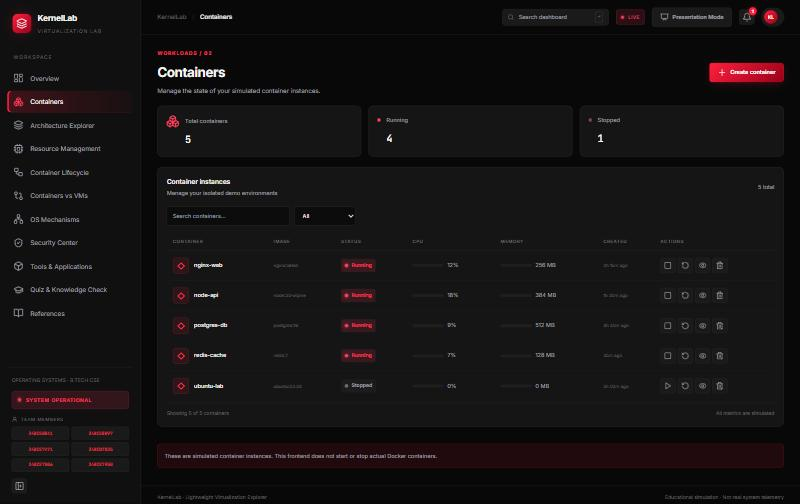
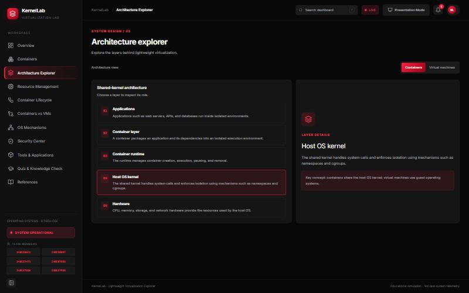
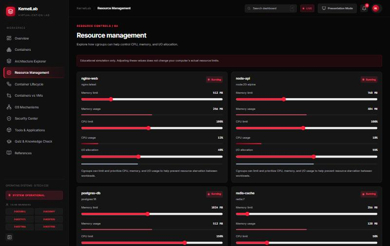
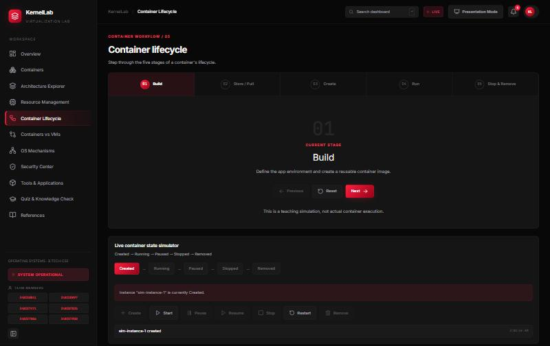
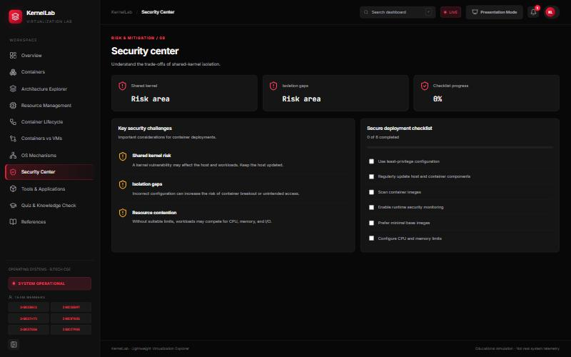
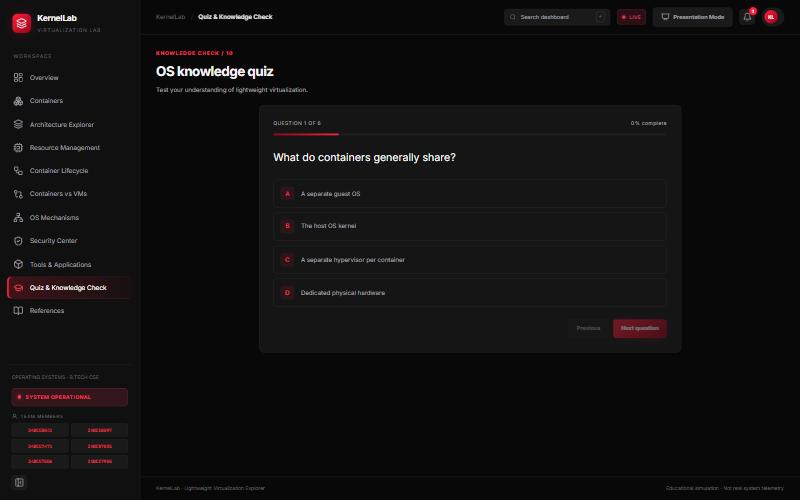
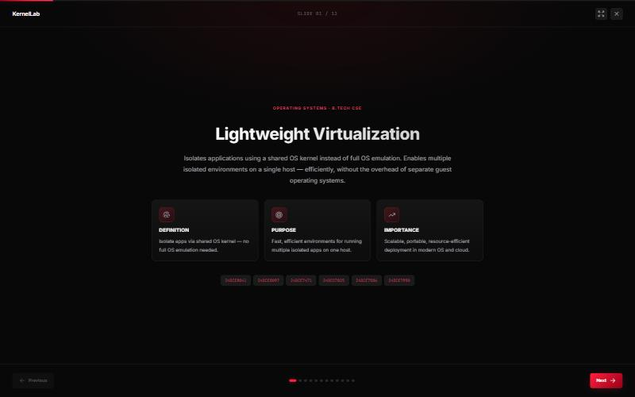

<!-- Header -->
<p align="center">
  
</p>

<!-- Views -->
<p align="right">
  <a href="https://github.com/Sumit0802-afk/Lightweight-Virtualization-Dashboard">
    
  </a>
</p>

<!-- Typing SVG -->
<p align="center">
  <a href="https://lightweight-liart.vercel.app">
    
  </a>
</p>

<!-- Links -->
<p align="center">
  <a href="https://lightweight-liart.vercel.app" target="_blank">
    
  </a>&nbsp;
  <a href="https://github.com/Sumit0802-afk/Lightweight-Virtualization-Dashboard" target="_blank">
    
  </a>&nbsp;
  <a href="#-quick_start">
    
  </a>&nbsp;
  <a href="https://lightweight-liart.vercel.app/#/presentation">
    
  </a>
</p>

<p align="center">
  
  
  
  
  
  
</p>

<br>

<!-- At a glance -->
<table align="center">
  <tr>
    <td align="center" width="25%" valign="top">
      <h3>🖥️</h3>
      <b>Command Center</b><br>
      <sub>A hero overview with sparkline metrics and live resource charts</sub>
    </td>
    <td align="center" width="25%" valign="top">
      <h3>📦</h3>
      <b>Container Management</b><br>
      <sub>Create, start, stop, inspect and remove simulated containers</sub>
    </td>
    <td align="center" width="25%" valign="top">
      <h3>🔄</h3>
      <b>Lifecycle Simulator</b><br>
      <sub>Build → Run, plus a live Created → Running → Removed state machine</sub>
    </td>
    <td align="center" width="25%" valign="top">
      <h3>🎞️</h3>
      <b>Presentation Mode</b><br>
      <sub>A full-screen, 12-slide walkthrough of the whole syllabus topic</sub>
    </td>
  </tr>
</table>

<br>

<blockquote align="center">
  <b>Isolated environments. Shared kernel. Maximum efficiency.</b>
</blockquote>

<!-- How a container is taught here -->


<br>

<!-- About -->
## `> about.js`

```javascript
const kernellab = {
    name: "KernelLab — Extreme Red Edition",
    tagline: "Isolated environments. Shared kernel. Maximum efficiency.",
    what: "An interactive Operating Systems dashboard on Lightweight Virtualization, styled as a red/black cyber command center",
    liveDemo: "https://lightweight-liart.vercel.app",
    course: "Operating Systems, B.Tech CSE",
    modules: [
        "Overview", "Containers", "Architecture Explorer", "Resource Management",
        "Container Lifecycle", "Containers vs VMs", "OS Mechanisms", "Security Center",
        "Tools & Applications", "Quiz & Knowledge Check", "References", "Presentation Mode"
    ],
    stack: {
        frontend: ["React 18", "Vite", "React Router", "Tailwind CSS"],
        charts: ["Recharts"],
        icons: ["Lucide React"],
        hosting: ["Vercel", "GitHub Pages"]
    },
    data: "every metric, container and log entry is simulated for teaching — no real Docker runtime"
};
```

<p align="center">
  
</p>

<!-- Tech Stack -->
## `> tech_stack`

<p align="center">
  <a href="https://skillicons.dev">
    
  </a>
</p>

<p align="center">
  
</p>

<!-- Features -->
## `> features`

<table align="center">
  <tr>
    <td width="33%" valign="top">
      📊 &nbsp;<b>Overview</b><br>
      <sub>Metric cards, sparklines, a 1H/6H/24H/7D resource chart</sub>
    </td>
    <td width="33%" valign="top">
      📦 &nbsp;<b>Containers</b><br>
      <sub>Create, start, stop, restart, inspect and remove</sub>
    </td>
    <td width="33%" valign="top">
      🧬 &nbsp;<b>Architecture Explorer</b><br>
      <sub>Shared-kernel stack vs. VM/hypervisor stack</sub>
    </td>
  </tr>
  <tr>
    <td width="33%" valign="top">
      ⚙️ &nbsp;<b>Resource Management</b><br>
      <sub>Per-container CPU, memory and I/O limit sliders</sub>
    </td>
    <td width="33%" valign="top">
      🔄 &nbsp;<b>Container Lifecycle</b><br>
      <sub>PPT stepper, plus a live Created → Removed simulator</sub>
    </td>
    <td width="33%" valign="top">
      ⚖️ &nbsp;<b>Containers vs VMs</b><br>
      <sub>Side-by-side comparison with a feature table</sub>
    </td>
  </tr>
  <tr>
    <td width="33%" valign="top">
      🧩 &nbsp;<b>OS Mechanisms</b><br>
      <sub>Namespaces, cgroups, with a per-container inspector</sub>
    </td>
    <td width="33%" valign="top">
      🛡️ &nbsp;<b>Security Center</b><br>
      <sub>Risks and an interactive deployment checklist</sub>
    </td>
    <td width="33%" valign="top">
      🐳 &nbsp;<b>Tools & Applications</b><br>
      <sub>Docker, Podman, LXC, Kubernetes</sub>
    </td>
  </tr>
  <tr>
    <td width="33%" valign="top">
      🧠 &nbsp;<b>Quiz & Knowledge Check</b><br>
      <sub>Scored multiple-choice quiz with explanations</sub>
    </td>
    <td width="33%" valign="top">
      📚 &nbsp;<b>References</b><br>
      <sub>Sources, conclusion and the team</sub>
    </td>
    <td width="33%" valign="top">
      🎞️ &nbsp;<b>Presentation Mode</b><br>
      <sub>Full-screen, 12-slide walkthrough with keyboard nav</sub>
    </td>
  </tr>
</table>

<details>
<summary><b>Every module, in detail</b></summary>
<br>

```javascript
const modules = {
    overview: "command-center hero, sparkline metric cards, live resource chart, activity log, quick actions",
    containers: "search, filter, create with CPU/memory limits, start/stop/restart, inspect panel, remove with confirmation",
    architecture: "clickable shared-kernel layers vs. a VM/hypervisor toggle, with a detail side panel",
    resources: "cgroups-style sliders per container — memory limit, CPU limit, I/O allocation",
    lifecycle: "Build -> Store/Pull -> Create -> Run -> Stop & Remove stepper, plus a Created -> Running -> Paused -> Stopped -> Removed live simulator",
    comparison: "containers vs. virtual machines — kernel usage, isolation, startup, overhead, portability",
    osMechanisms: "PID, Network, Mount, IPC, UTS and User namespaces, inspected per running container",
    security: "shared-kernel risks, isolation gaps, and a checked-off secure-deployment checklist",
    tools: "Docker, Podman, LXC and Kubernetes, plus real-world use cases and future scope",
    quiz: "one question at a time, instant feedback, a final score and a restart",
    references: "the textbook and docs used, plus a team-members grid",
    presentation: "full-screen slides, arrow-key navigation, a progress bar and a fullscreen toggle"
};
```

</details>

<p align="center">
  
</p>

<!-- Quick Start -->
## `> quick_start`

**You need:** Node.js 18 or newer, and npm.

```bash
# 1. clone
git clone https://github.com/Sumit0802-afk/Lightweight-Virtualization-Dashboard.git
cd Lightweight-Virtualization-Dashboard

# 2. install and run  ->  http://localhost:5173
npm install
npm run dev
```

```bash
# production build, root-relative paths (Vercel, local preview)
npm run build

# GitHub Pages build, subpath-relative paths
npm run build:pages

# publish dist/ to the gh-pages branch
npm run deploy
```

<p align="center">
  
</p>

<!-- Architecture -->
## `> architecture`

```
kernellab-dashboard/
├── src/
│   ├── components/     Layout · MetricCard · ContainerTable · ActivityLog · ArchitectureDiagram
│   ├── context/         DashboardContext — simulated containers, activity log, security state
│   ├── pages/           Dashboard · Containers · Architecture · Resources · Lifecycle ·
│   │                     Comparison · OSMechanisms · Security · Tools · Quiz · References ·
│   │                     Presentation
│   └── index.css        design tokens — the red/black theme, layout and components
├── vite.config.js       default root base (Vercel); --base override for GitHub Pages
└── docs/screenshots/    the images used in this README
```

<p align="center">
  
</p>

<!-- Deploy -->
## `> deploy`

The live demo is hosted free on Vercel, with a GitHub Pages mirror.

```yaml
primary:
  host: Vercel
  framework: Vite
  buildCommand: npm run build
  outputDirectory: dist

mirror:
  host: GitHub Pages
  branch: gh-pages
  buildCommand: npm run build:pages   # --base=/Lightweight-Virtualization-Dashboard/
  router: HashRouter                  # so deep links always resolve on a static host
```

<p align="center">
  
</p>

<!-- Demo screenshots -->
## `> screenshots`

<table align="center">
  <tr>
    <td width="50%"><br><sub align="center">Overview — System Command Center</sub></td>
    <td width="50%"><br><sub align="center">Containers</sub></td>
  </tr>
  <tr>
    <td width="50%"><br><sub align="center">Architecture Explorer</sub></td>
    <td width="50%"><br><sub align="center">Resource Management</sub></td>
  </tr>
  <tr>
    <td width="50%"><br><sub align="center">Container Lifecycle</sub></td>
    <td width="50%"><br><sub align="center">Security Center</sub></td>
  </tr>
  <tr>
    <td width="50%"><br><sub align="center">Quiz & Knowledge Check</sub></td>
    <td width="50%"><br><sub align="center">Presentation Mode</sub></td>
  </tr>
</table>

<p align="center">
  
</p>

<!-- Roadmap -->
## `> roadmap`

**Shipped**

| Area | What is in it |
| :--- | :--- |
| ✅ &nbsp;**Theme** | A complete red/black "Extreme Red" redesign — tokens, glow, sparklines |
| ✅ &nbsp;**Overview** | Command-center hero, live metrics, a 1H/6H/24H/7D chart |
| ✅ &nbsp;**Containers** | Full CRUD, search/filter, an inspect panel |
| ✅ &nbsp;**Lifecycle** | The PPT stepper plus a live state-machine simulator |
| ✅ &nbsp;**Presentation Mode** | 12 slides, icons, a progress bar, keyboard navigation |
| ✅ &nbsp;**Hosting** | Deployed on Vercel, mirrored on GitHub Pages |

**Next**

| Area | What is planned | Waiting on |
| :--- | :--- | :--- |
| 🔜 &nbsp;**Real telemetry** | An optional read-only view of actual local Docker containers | A small local backend |
| 🔜 &nbsp;**Persistence** | Remember container state and quiz scores across reloads | Local storage or a backend |
| 🔜 &nbsp;**Code-splitting** | Trim the single JS bundle for a faster first load | Route-based lazy loading |

<p align="center">
  
</p>

<!-- Repository -->
## `> repository`

<p align="center">
  <a href="https://github.com/Sumit0802-afk/Lightweight-Virtualization-Dashboard">
    
  </a>
</p>

<p align="center">
  
</p>

<!-- Team -->
## `> team`

<p align="center">
  Built for <b>Operating Systems</b>, B.Tech CSE — a group project on Lightweight Virtualization.
</p>

<table align="center">
  <tr>
    <td align="center" width="16%"><sub><b>24BCE8041</b></sub></td>
    <td align="center" width="16%"><sub><b>24BCE8097</b></sub></td>
    <td align="center" width="16%"><sub><b>24BCE7471</b></sub></td>
    <td align="center" width="16%"><sub><b>24BCD7025</b></sub></td>
    <td align="center" width="16%"><sub><b>24BCE7506</b></sub></td>
    <td align="center" width="16%"><sub><b>24BCE7950</b></sub></td>
  </tr>
</table>

<br>

<table align="center">
  <tr>
    <td align="center" width="210">
      <sub><b>COMMITS</b></sub><br><br>
      
    </td>
    <td align="center" width="210">
      <sub><b>LAST&nbsp;COMMIT</b></sub><br><br>
      
    </td>
    <td align="center" width="210">
      <sub><b>TOP&nbsp;LANGUAGE</b></sub><br><br>
      
    </td>
    <td align="center" width="210">
      <sub><b>CODE&nbsp;SIZE</b></sub><br><br>
      
    </td>
  </tr>
</table>

<p align="center">
  
</p>

<!-- Notes -->
<p align="center">
  <sub>All CPU, memory, container status and network values are simulated educational data — not real host telemetry.<br>Container controls update local React state only; they do not run Docker or any real container runtime.</sub>
</p>

<p align="center">
  
</p>
